

# ShashevPro CRM

**CRM для малого бизнеса: клиенты, сделки, счета, акты и налоги УСН в одном окне**

Работает на компьютере без интернета или на вашем сервере с любого устройства. Без абонентской платы.

[Купить](https://shashevpro.ru) · [Руководство пользователя (PDF)](docs/ShashevPro_CRM_Rukovodstvo.pdf) · [Поддержка](mailto:programmer@shashevpro.ru)

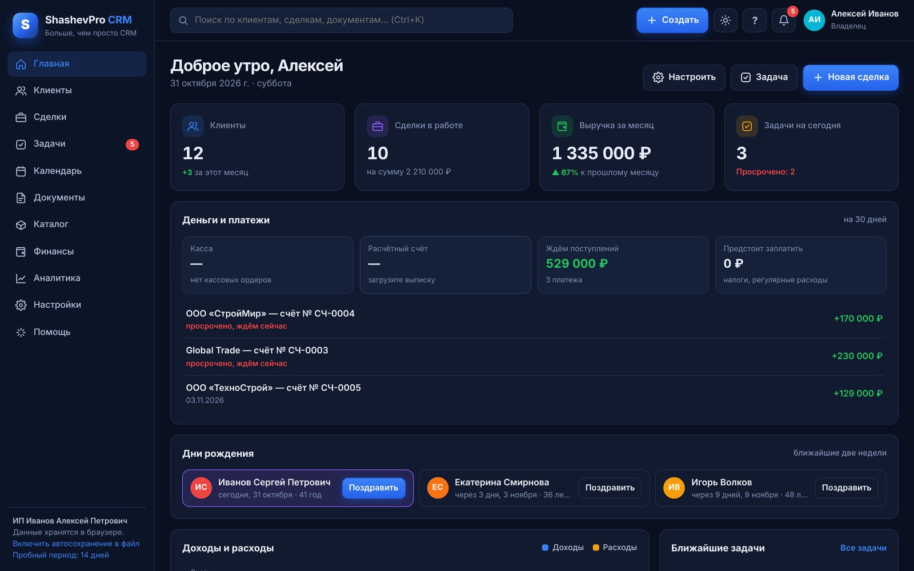

> **Это витрина коммерческого продукта.** Исходный код и файлы программы здесь не публикуются. Программа распространяется по платной лицензии через [shashevpro.ru](https://shashevpro.ru) и Kwork.

---

## Для кого

Для ИП, ООО и самозанятых, которым нужно вести клиентов, выставлять документы и видеть деньги, но не хочется платить за облачную CRM каждый месяц. Весь интерфейс и все документы на русском языке, по российским формам.

## Возможности

| Раздел | Что умеет |
|---|---|
| **Клиенты** | Карточка с историей, контактами, файлами и долгами. Реквизиты по ИНН заполняются сами (DaData). Импорт из Excel, CSV и 1С |
| **Сделки** | Воронка продаж с перетаскиванием, свои этапы, автозадачи по этапам, счета и оплаты прямо в сделке |
| **Задачи и календарь** | Звонки, встречи, письма, повторяющиеся задачи, напоминания со звуком, дни рождения клиентов |
| **Документы** | КП, счёт с QR-кодом для оплаты, счёт-оферта, договор, акт, УПД, счёт-фактура, ТОРГ-12, ПКО, РКО, свои письма. PDF, печать и файл для Word в один клик |
| **Финансы** | Доходы и расходы, выписка банка в формате 1С, кассовая книга, КУДиР, оценка налога УСН и взносов ИП, «Пакет для бухгалтера» |
| **Каталог и склад** | Товары и услуги для документов, остатки, поступления, автосписание по УПД и ТОРГ-12 |
| **Аналитика** | Выручка, конверсия, средний чек, источники клиентов, лучшие клиенты, отчёты в PDF |
| **Несколько организаций** | Несколько ИП или компаний в одной программе: свои реквизиты, нумерация и финансы |
| **Сохранность данных** | Автосохранение в файл, резервные копии, точки восстановления, корзина на 30 дней, PIN-код |

## Два режима работы

**На компьютере.** Программа открывается в браузере Chrome, Edge или Яндекс как отдельное окно. Интернет не нужен, данные хранятся только у вас.

**На своём сервере.** Установка на любой VPS (Ubuntu, Debian, CentOS, AlmaLinux, Rocky) одним файлом. Вход по логину с компьютера и телефона, несколько сотрудников, синхронизация и ежедневные копии базы. Домен и сертификат не нужны — HTTPS настраивается сам. Установщик не трогает другие сайты, VPN и ботов на сервере.

## Скриншоты

<table>
<tr>
<td width="50%">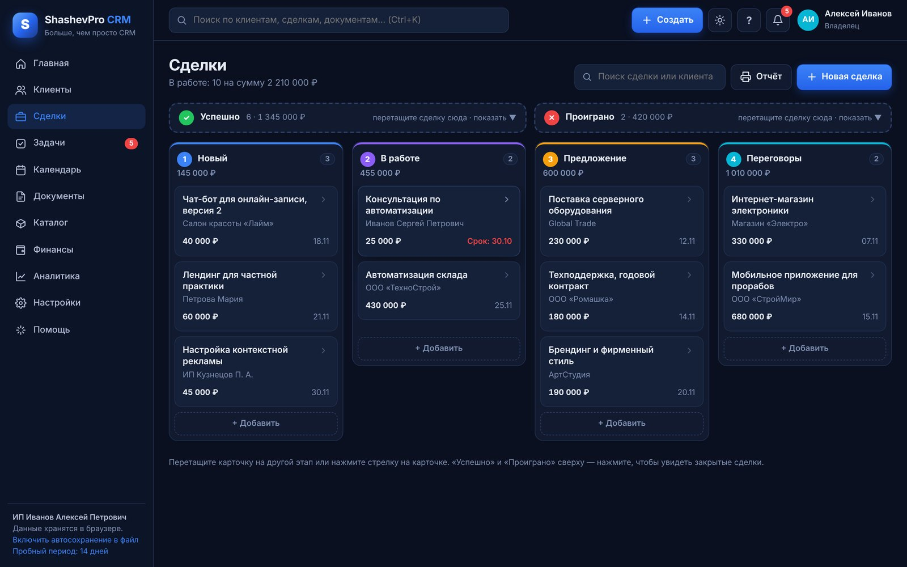 Воронка сделок</td>
<td width="50%">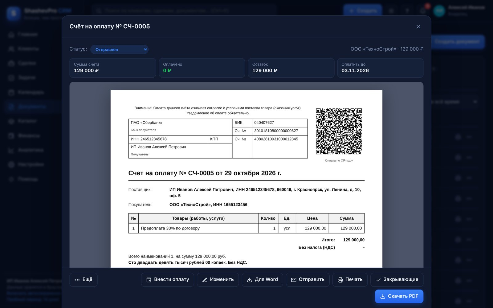 Счёт на оплату с QR-кодом</td>
</tr>
<tr>
<td>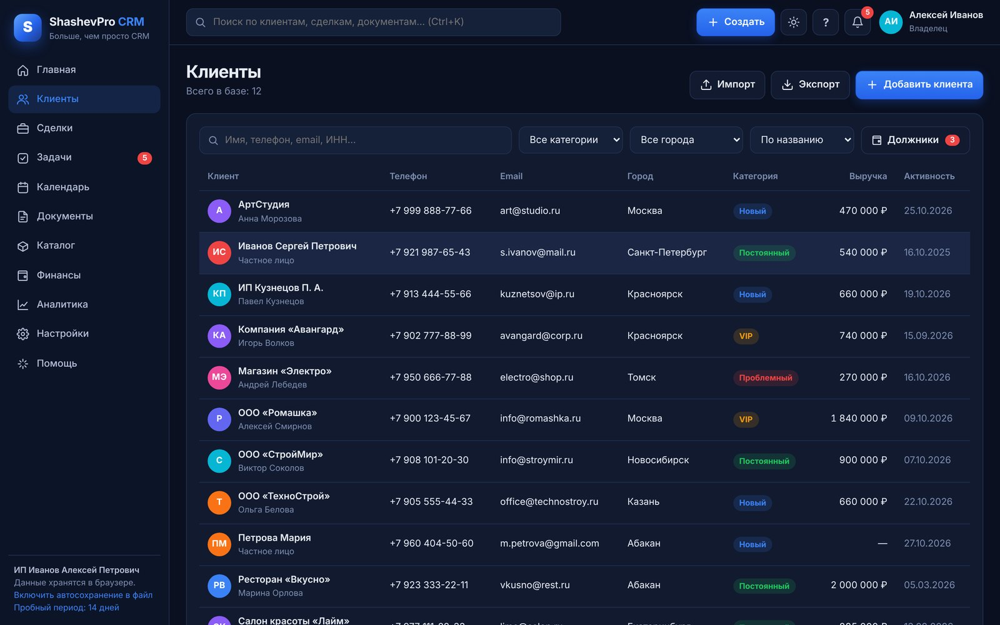 База клиентов</td>
<td>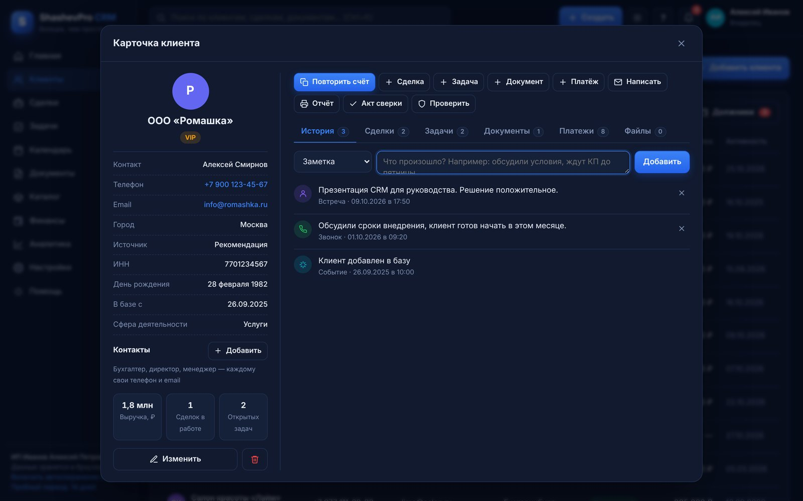 Карточка клиента</td>
</tr>
<tr>
<td>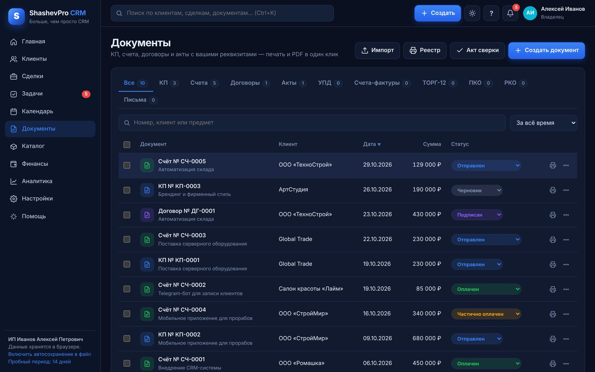 Документы</td>
<td>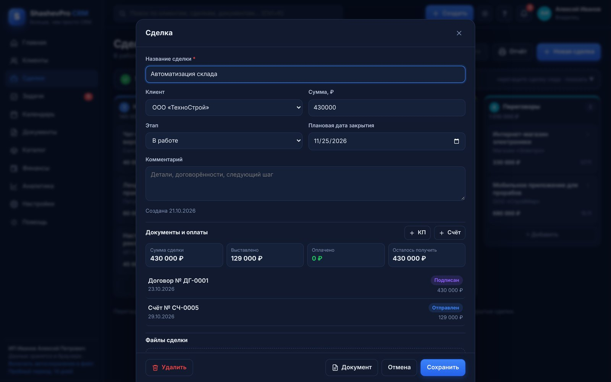 Сделка с документами и оплатами</td>
</tr>
<tr>
<td>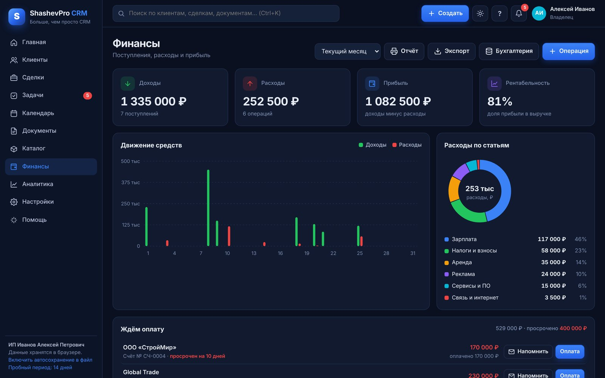 Финансы</td>
<td>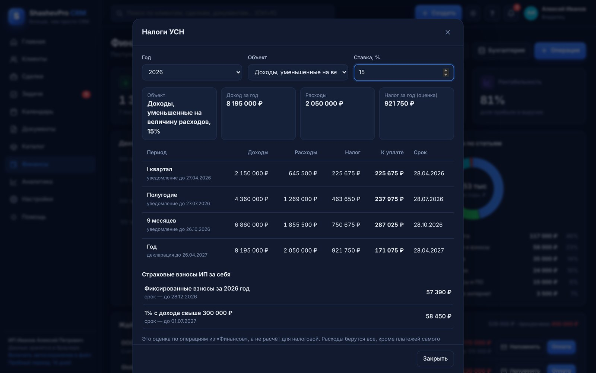 Налоги УСН и взносы ИП</td>
</tr>
<tr>
<td>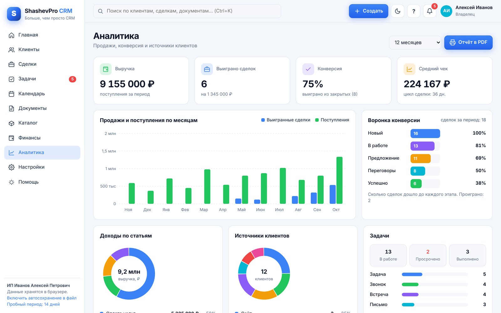 Аналитика (светлая тема)</td>
<td>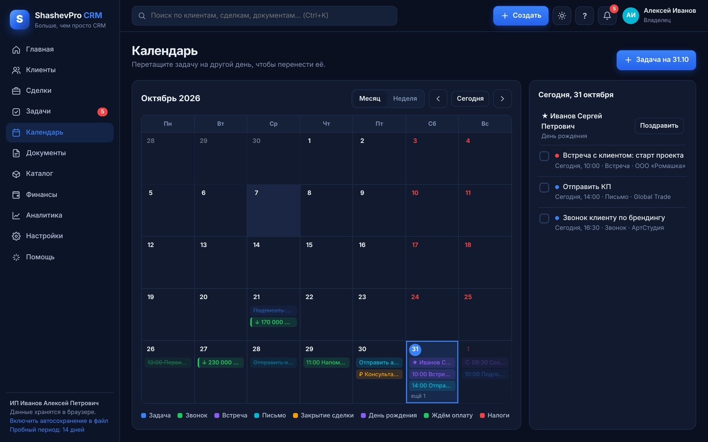 Календарь</td>
</tr>
<tr>
<td>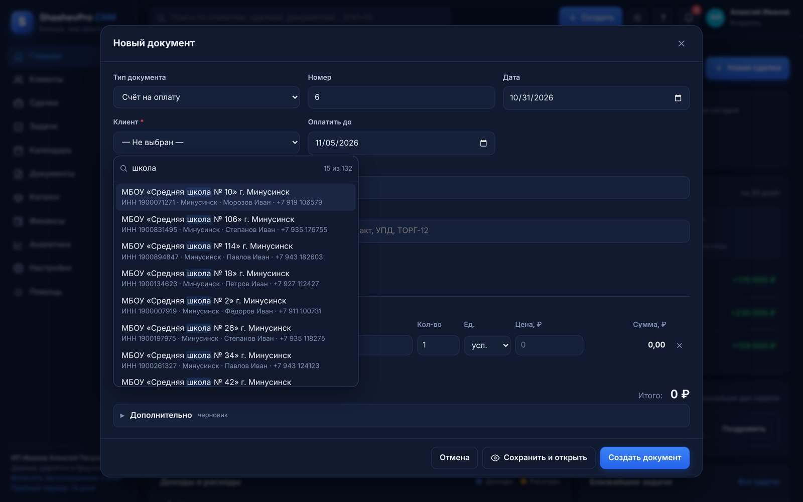 Поиск клиента среди сотен записей</td>
<td>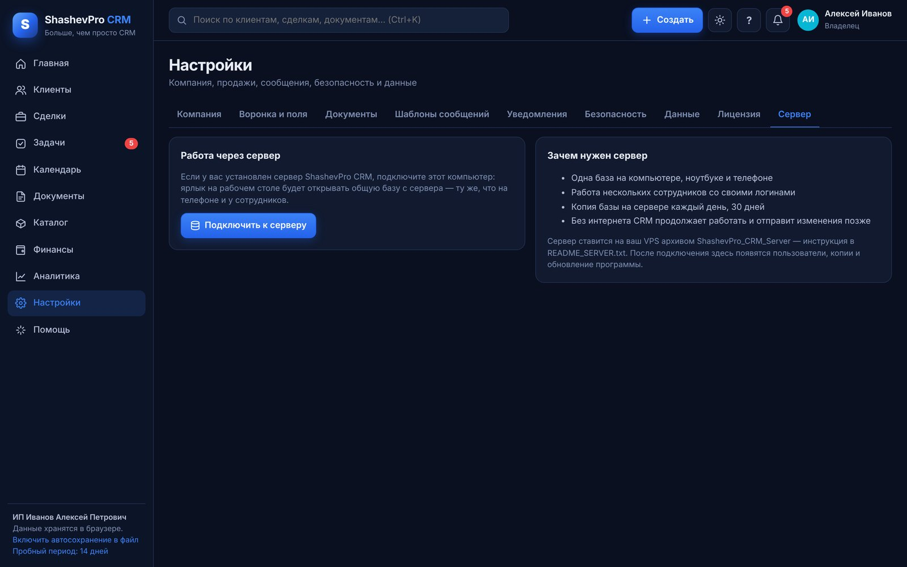 Подключение к серверу</td>
</tr>
</table>

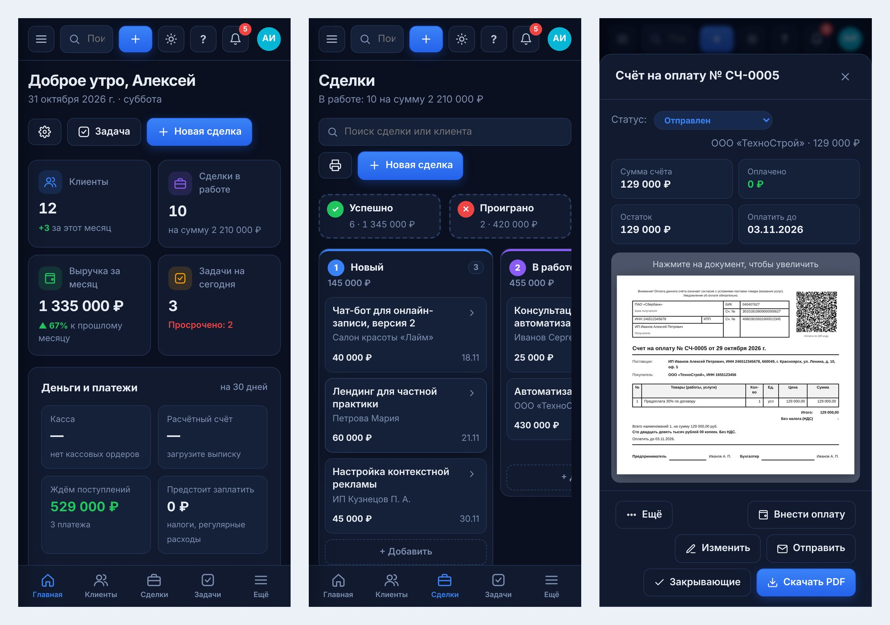

## Системные требования

- Windows 10 или 11 (также macOS и Linux через браузер)
- Google Chrome, Microsoft Edge или Яндекс Браузер
- Для режима сервера: VPS от 1 ГБ памяти и доступ root

## Как купить

1. Оформите покупку на [shashevpro.ru](https://shashevpro.ru) или на Kwork.
2. Получите архив с программой, руководство пользователя и лицензионный ключ.
3. Первые 14 дней программа работает без ключа со всеми функциями.

Подробная инструкция со скриншотами: [docs/ShashevPro_CRM_Rukovodstvo.pdf](docs/ShashevPro_CRM_Rukovodstvo.pdf).

## Поддержка

- Сайт: [shashevpro.ru](https://shashevpro.ru)
- Email: [programmer@shashevpro.ru](mailto:programmer@shashevpro.ru)

## Лицензия

Коммерческое программное обеспечение. © 2026 ИП Шашев Андрей Сергеевич. Все права защищены. Подробнее — в файле [LICENSE.md](LICENSE.md).
